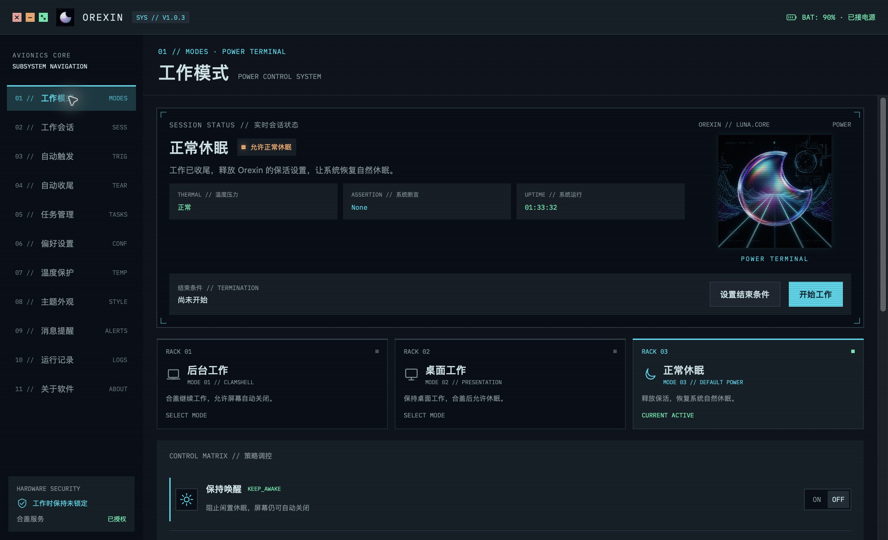

<p align="center">
  
</p>

# Orexin

[简体中文](README.zh-Hans.md) · [繁體中文](README.zh-Hant.md) · [English](README.md) · [日本語](README.ja.md) · [Français](README.fr.md) · **Deutsch** · [Español](README.es.md)

[](https://github.com/Orxooo/Orexin/releases/latest)

[](https://github.com/Orxooo/Orexin/actions/workflows/compatibility.yml)
[](LICENSE)

Orexin ist eine macOS-Menüleisten-App, mit der du festlegst, wann dein Mac wach bleibt und wann er in den Ruhezustand wechseln darf.

Nutze sie beim Kompilieren, Herunterladen, Präsentieren oder für lange Aufgaben – am Schreibtisch oder mit geschlossenem Deckel. Zeitlich begrenzte Sitzungen, automatische Regeln und Befehlsaufgaben bestimmen, wann der Mac nicht mehr wach gehalten werden soll.

[Neueste Version herunterladen](https://github.com/Orxooo/Orexin/releases/latest) · [Änderungsprotokoll](CHANGELOG.de.md) · [Handbuch](https://github.com/Orxooo/Orexin/wiki)



## Funktionen

- **Arbeitsmodi:** „Hintergrundarbeit“ verhindert den Ruhezustand bei geschlossenem Deckel. „Arbeit am Schreibtisch“ verhindert den Ruhezustand bei Inaktivität, erlaubt ihn aber beim Zuklappen.
- **Bildschirmsteuerung:** Helligkeit auf 0 % setzen, normale Helligkeit beibehalten, den Bildschirm nach dem Systemzeitplan oder sofort ausschalten. Beide Arbeitsmodi speichern ihre Einstellung getrennt.
- **Arbeitssitzungen:** Nach einer bestimmten Dauer, zu einer festgelegten Uhrzeit, beim Beenden einer App oder eines Prozesses oder nach Abschluss eines Downloads enden.
- **Befehle und Ausführungspläne:** Befehle parallel ausführen und ihre Exit-Codes und Protokolle einsehen. Abhängigkeiten, Parallelitätsgrenzen und Verzweigungen für Fehlerfälle lassen sich in JSON definieren.
- **Automatische Regeln und Profile:** Arbeit anhand von Stromversorgung, Bildschirmen, Geräten, Apps, Netzwerk oder Uhrzeit auslösen. Verschachtelte Bedingungen, Testläufe sowie der Import und Export von Konfigurationen werden unterstützt.
- **Schutz und Hinweise:** Optionaler Schutz bei niedrigem Akkustand und hoher Wärmebelastung, Meldungen zu Dienstproblemen, Vorwarnungen vor dem Sitzungsende und Update-Hinweise. Systemmitteilungen und Pop-ups in der App werden unterstützt; Updates werden manuell installiert.

Enthält die drei Designs Tron, Zima Blue und Blade Runner 2049 und unterstützt vereinfachtes Chinesisch, traditionelles Chinesisch, Englisch, Japanisch, Französisch, Deutsch und Spanisch. Einzelheiten stehen in der [Funktionsübersicht](FEATURES.md).

## Erste Schritte

<a id="系统要求"></a>

Erfordert einen **Mac mit Apple Silicon und macOS 15 oder neuer**.

1. Lade das Apple-Silicon-Paket (Dateiname endet auf `-arm64.zip`) von der [Release-Seite](https://github.com/Orxooo/Orexin/releases/latest) herunter, entpacke es und verschiebe `Orexin.app` in den Ordner „Programme“.
2. Öffne die App und wähle einen Arbeitsmodus und eine Endbedingung. Für die Arbeit mit geschlossenem Deckel muss der Hilfsdienst in den „Einstellungen“ genehmigt werden.
3. Wenn du Systemmitteilungen erhalten möchtest, erlaube sie unter „Meldungen und Hinweise“ und sende eine Testmitteilung.

Das Paket ist **mit Apple Development signiert und noch nicht mit Developer ID notarisiert**. Falls macOS den ersten Start blockiert, überprüfe die Downloadquelle und folge den Hinweisen unter „Datenschutz & Sicherheit“. SIP oder Gatekeeper müssen dafür nicht systemweit deaktiviert werden.

Um den Download zu prüfen, lege die ZIP-Datei und die Datei `SHA256SUMS.txt` der Veröffentlichung im selben Verzeichnis ab:

```sh
shasum -a 256 -c SHA256SUMS.txt
```

### Aktualisieren

Warte, bis Befehle und Ausführungspläne abgeschlossen sind, beende alle Anforderungen zum Wachhalten und stoppe anschließend den Hintergrunddienst für Aufgaben:

```sh
/Applications/Orexin.app/Contents/Helpers/orexin service-stop
```

Beende danach Orexin, ersetze die App und öffne sie erneut. Überspringe den Dienststopp, wenn deine bisherige Version den Befehl `service-stop` noch nicht unterstützt. Einstellungen, Verlauf und Protokolle bleiben erhalten; alte Aufgaben werden nicht erneut ausgeführt.

### Hinweise zur Nutzung

- „Während der Arbeit entsperrt bleiben“ ist optional und erfordert eine eigene Autorisierung. Die Einstellung deaktiviert die Passwortabfrage beim Aufwachen für die laufende Arbeit und stellt anschließend den sofortigen Passwortschutz wieder her. Orexin speichert keine Passwörter und entsperrt keinen gesperrten Mac.
- Helligkeit 0 % ist etwas anderes als ein ausgeschalteter Bildschirm. Bildschirmabhängige Screenshots oder UI-Automatisierungen können durch das Ausschalten beeinträchtigt werden.
- Die Rückkehr zu „Normaler Ruhezustand“ hebt nur die Anforderungen von Orexin zum Wachhalten auf. Andere Apps können den Ruhezustand weiterhin verhindern.
- Der Wärmeschutz verwendet die von macOS gemeldeten Wärmebelastungsstufen, keine Temperaturwerte in Grad Celsius. Nach dem Abkühlen wird gestoppte Arbeit nicht automatisch neu gestartet.

## Aufgabenverwaltung und CLI

Hintergrundbefehle und Ausführungspläne laufen weiter, wenn du die Benutzeroberfläche beendest. Manuelle Sitzungen und automatische Regeln benötigen dagegen den laufenden Oberflächenprozess. Nach einem Neustart des Dienstes werden nicht abgeschlossene Aufgaben als nicht mehr erreichbar markiert und nicht automatisch erneut ausgeführt.

Die CLI ist im App-Paket enthalten und muss nicht separat installiert werden:

```sh
orexin=/Applications/Orexin.app/Contents/Helpers/orexin
"$orexin" service-start
"$orexin" run --title Build -- make
"$orexin" list --json
```

Standardmäßig wird die Anforderung einer Aufgabe zum Wachhalten aufgehoben, sobald ihr Befehl endet. Mit `--after sleep` beginnt nach erfolgreichem Abschluss ein Countdown von 60 Sekunden bis zum Ruhezustand. Dafür müssen alle sich zeitlich überschneidenden Anforderungen erfolgreich abgeschlossen sein, und keine andere Sitzung oder Regel darf den Mac noch wach halten. Das Aufheben einer Anforderung beendet den zugehörigen Befehl nicht.

Die Autorisierung für „Während der Arbeit entsperrt bleiben“ muss vorher in der Benutzeroberfläche erfolgen; die CLI öffnet keine Passwortdialoge. Optionen, die Anbindung externer Aufgaben und Planformate sind in der [CLI-Anleitung](docs/CLI.md) und der [Anleitung zu Ausführungsplänen](docs/EXECUTION-PLANS.md) beschrieben.

## Aus dem Quellcode bauen

Erfordert **Xcode 26+ und Swift 6**.

```sh
git clone https://github.com/Orxooo/Orexin.git
cd Orexin
swift test --arch arm64 --scratch-path /tmp/orexin-test-build
./scripts/build-app.sh
```

Die Ausgabe liegt unter `/tmp/orexin-dist/Orexin.app` und wird standardmäßig ad hoc signiert. Für den Betrieb mit geschlossenem Deckel müssen die App und der Hilfsdienst mit demselben Apple-Entwicklerzertifikat signiert sein:

```sh
OREXIN_SIGN_IDENTITY='Certificate name or SHA-1' ./scripts/build-app.sh
```

Mit `OREXIN_BUILD_DIR` und `OREXIN_OUTPUT_DIR` kannst du das Build- und Ausgabeverzeichnis festlegen. Die CI ist für Xcode 26.3 unter macOS 15 / 26 konfiguriert; Ergebnisse findest du unter [Actions](https://github.com/Orxooo/Orexin/actions/workflows/compatibility.yml).

## Dokumentation und Rückmeldungen

- [Arbeitsprofile](docs/WORK-CONFIGURATION.md) · [AppleScript-Wörterbuch](Resources/Orexin.sdef) · [Sicherheitshinweise](SECURITY.md)
- [Problem melden](https://github.com/Orxooo/Orexin/issues/new/choose) · [Diskussionen](https://github.com/Orxooo/Orexin/discussions) · [Vertrauliche Meldung von Sicherheitslücken](https://github.com/Orxooo/Orexin/security/advisories/new)
- [Beitragen](CONTRIBUTING.md) · [Verhaltenskodex](CODE_OF_CONDUCT.md)

Lokaler Verlauf und Protokolle liegen unter `~/Library/Application Support/Orexin/`. Alte WakeMac-Daten werden nicht automatisch migriert oder gelöscht. Prüfe Protokolle auf private Informationen, bevor du sie teilst.

## Lizenz

[GPL-3.0-only](LICENSE) · © 2026 Orxooo. Lizenzen für Ressourcen Dritter sind in [NOTICE](NOTICE) aufgeführt.
