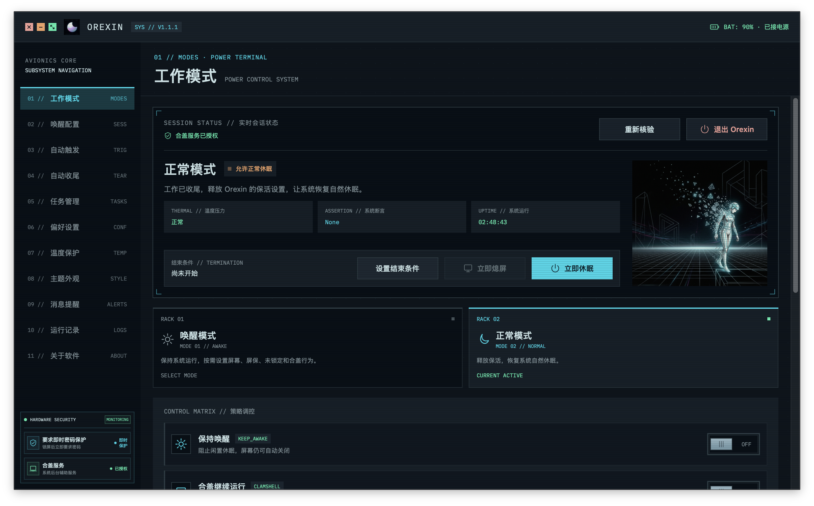

<p align="center">
  
</p>

# Orexin

[简体中文](README.zh-Hans.md) · [繁體中文](README.zh-Hant.md) · [English](README.md) · **日本語** · [Français](README.fr.md) · [Deutsch](README.de.md) · [Español](README.es.md)

[](https://github.com/Orxooo/Orexin/releases/latest)

[](https://github.com/Orxooo/Orexin/actions/workflows/compatibility.yml)
[](LICENSE)

Orexin は、Mac を起動状態に保つタイミングとスリープを許可するタイミングを管理する、macOS のメニューバーアプリです。

「スリープ防止モード」で Mac の動作を維持し、「通常モード」で Orexin のスリープ防止を解除します。画面、蓋を閉じた状態での動作、スクリーンセーバー、ロック解除の維持を個別に設定し、セッションやルール、コマンドで終了条件を管理できます。

[最新版をダウンロード](https://github.com/Orxooo/Orexin/releases/latest) · [変更履歴](CHANGELOG.ja.md) · [利用ガイド](https://github.com/Orxooo/Orexin/wiki)



## 機能

- **スリープ防止モードと通常モード：** スリープ防止モードでは Mac を動作させ、画面、蓋、スクリーンセーバー、ロックを必要に応じて設定できます。通常モードでは Orexin のスリープ防止を解除します。
- **画面の制御：** 最小または通常の明るさ、システム設定の消灯時間、即時消灯を選べます。最小の明るさを使った後、新たにスリープ防止を始めると通常の明るさに戻ります。
- **作業セッション：** 一定時間の経過、指定時刻、アプリやプロセスの終了、ダウンロードの完了などを条件に終了できます。
- **コマンドと実行プラン：** コマンドを並列実行し、終了コードやログを確認できます。JSON で依存関係、同時実行数の上限、失敗時の分岐を定義できます。
- **自動ルールとプロファイル：** 電源、ディスプレイ、デバイス、アプリ、ネットワーク、時刻を条件に作業を開始できます。条件の入れ子、試行実行、設定のインポートとエクスポートに対応します。
- **保護と通知：** バッテリー残量低下や熱負荷に対する保護を任意で有効にできます。サービスの異常、セッション終了の予告、アップデートの案内を、システム通知やアプリ内ポップアップで受け取れます。アップデートは手動でインストールします。

トロン、ジーマ・ブルー、ブレードランナー 2049 の 3 つのテーマを用意し、簡体字中国語、繁体字中国語、英語、日本語、フランス語、ドイツ語、スペイン語の 7 言語に対応しています。詳しくは[機能一覧](FEATURES.md)をご覧ください。

## 使い始める

<a id="系统要求"></a>

**Apple Silicon 搭載 Mac と macOS 15 以降**が必要です。

1. [リリースページ](https://github.com/Orxooo/Orexin/releases/latest)から Apple Silicon 用パッケージ（ファイル名の末尾が `-arm64.zip`）をダウンロードして展開し、`Orexin.app` を「アプリケーション」に移動します。
2. アプリを開き、作業モードと終了条件を選びます。蓋を閉じた状態で実行するには、「環境設定」でヘルパーサービスを承認する必要があります。
3. システム通知を受け取る場合は、「メッセージと通知」で通知を許可し、テスト通知を送信します。

パッケージは **Apple Development 証明書で署名されていますが、Developer ID による公証は未完了**です。初回起動がブロックされた場合は、ダウンロード元を確認したうえで、macOS の「プライバシーとセキュリティ」の案内に従ってください。SIP や Gatekeeper をシステム全体で無効にする必要はありません。

ダウンロードしたファイルを検証するには、ZIP とリリースページの `SHA256SUMS.txt` を同じディレクトリに置いて実行します。

```sh
shasum -a 256 -c SHA256SUMS.txt
```

### アップグレード

コマンドと実行プランが完了するのを待ち、すべてのスリープ防止要求を終了してから、バックグラウンドタスクサービスを停止します。

```sh
/Applications/Orexin.app/Contents/Helpers/orexin service-stop
```

続いて Orexin を終了し、アプリを置き換えて再度開きます。旧バージョンに `service-stop` コマンドがない場合は、サービスの停止手順を省略してください。既存の設定、履歴、ログは保持され、古いタスクが再実行されることはありません。

### 使用上の注意

- 「作業中はロックしない」は任意の設定で、アカウント認証が必要です。作業中はスリープ解除時のパスワード要求を無効にし、終了後は即時パスワード保護に戻します。「設定 → コアと認証」の「アカウントのパスワードを保存して自動認証」は既定でオフです。有効にすると、認証と検証の成功後にのみパスワードをこの Mac のキーチェーンに保存します。iCloud では同期しません。オフにすると保存したパスワードを削除します。保存したパスワードがない場合は新しい作業ごとに入力を求めます。保存したパスワードが拒否された場合は削除し、手動で一度だけ再試行できます。ロック済みの Mac を解除することはできません。
- 明るさ 0% と画面の消灯は異なります。画面の状態に依存するスクリーンショットや UI 自動操作は、消灯によって影響を受ける場合があります。
- 「通常モード」に戻すと、Orexin のスリープ防止要求だけが解除されます。他のアプリが引き続きスリープを妨げる場合があります。
- 熱保護は macOS の熱負荷レベルに基づいて動作し、摂氏温度は表示しません。温度が下がっても、停止した作業は自動で再開しません。
- ヘルパーサービスの接続が切れて作業が終了した場合は、「通常モード」に切り替え、「設定 → コアと認証」でコアを再起動してから作業を再開してください。
- セッションやルールの通知設定を変更した後、または初めてシステム通知を許可した後は、コアを再起動して設定を反映してください。

## タスク管理と CLI

バックグラウンドコアが手動の作業モード、タイマー付きセッション、自動ルール、コマンド、実行プランを管理し、画面を終了しても実行を続けます。ホットキーと AppleScript のディスパッチには GUI プロセスが必要です。コアの再起動後に以前の作業は再実行しません。未完了のタスクは接続喪失として記録します。

CLI はアプリに同梱されており、別途インストールする必要はありません。

```sh
orexin=/Applications/Orexin.app/Contents/Helpers/orexin
"$orexin" service-start
"$orexin" run --title Build -- make
"$orexin" list --json
```

既定では、コマンドの終了後にそのタスクのスリープ防止要求を解除します。`--after sleep` を付けると、成功後にスリープまでの 60 秒間のカウントダウンを開始できます。同時期に重なる要求がすべて成功し、他のセッションやルールがスリープを防止していないことが条件です。スリープ防止要求を解除しても、コマンドは終了しません。

「作業中はロックしない」の認証は、あらかじめアプリの画面で済ませる必要があります。CLI ではパスワード入力画面を表示しません。オプション、外部タスクとの連携、プランの形式については、[CLI ガイド](docs/CLI.md)と[実行プランガイド](docs/EXECUTION-PLANS.md)をご覧ください。

## ソースからビルドする

**Xcode 26+ と Swift 6** が必要です。

```sh
git clone https://github.com/Orxooo/Orexin.git
cd Orexin
swift test --arch arm64 --scratch-path /tmp/orexin-test-build
./scripts/build-app.sh
```

ローカルビルドは既定で Dev チャンネルを使用します。安定版のビルドには `OREXIN_BUILD_CHANNEL=stable` を設定し、公開バージョンを `OREXIN_VERSION` で指定します。

出力先は `/tmp/orexin-dist/Orexin.app` で、既定ではアドホック署名を使用します。蓋を閉じた状態で動作させるには、アプリ本体とヘルパーサービスを同じ Apple 開発者証明書で署名する必要があります。

```sh
OREXIN_SIGN_IDENTITY='Certificate name or SHA-1' ./scripts/build-app.sh
```

`OREXIN_BUILD_DIR` と `OREXIN_OUTPUT_DIR` で、ビルド先と出力先のディレクトリを指定できます。CI は Xcode 26.3、macOS 15 / 26 を対象に設定されています。実行結果は [Actions](https://github.com/Orxooo/Orexin/actions/workflows/compatibility.yml) で確認できます。

## ドキュメントとフィードバック

- [作業プロファイル](docs/WORK-CONFIGURATION.md) · [AppleScript 辞書](Resources/Orexin.sdef) · [セキュリティについて](SECURITY.md)
- [問題を報告](https://github.com/Orxooo/Orexin/issues/new/choose) · [ディスカッション](https://github.com/Orxooo/Orexin/discussions) · [脆弱性を非公開で報告](https://github.com/Orxooo/Orexin/security/advisories/new)
- [貢献ガイド](CONTRIBUTING.md) · [行動規範](CODE_OF_CONDUCT.md)

ローカルの履歴とログは `~/Library/Application Support/Orexin/` に保存されます。旧 WakeMac のデータは、自動で移行・削除されません。ログを共有する前に、個人情報が含まれていないか確認してください。

## ライセンス

[GPL-3.0-only](LICENSE) · © 2026 Orxooo。サードパーティ製リソースのライセンスは [NOTICE](NOTICE) に記載しています。
