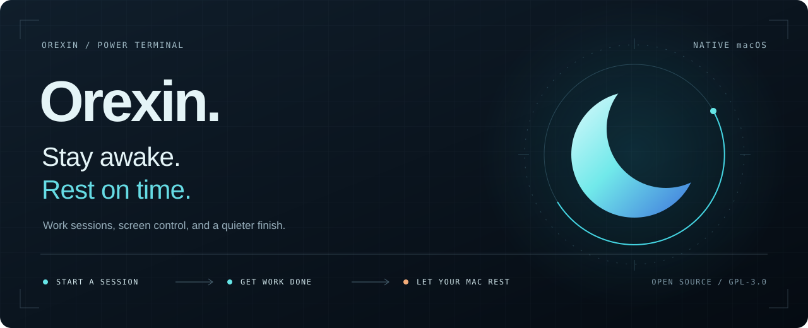
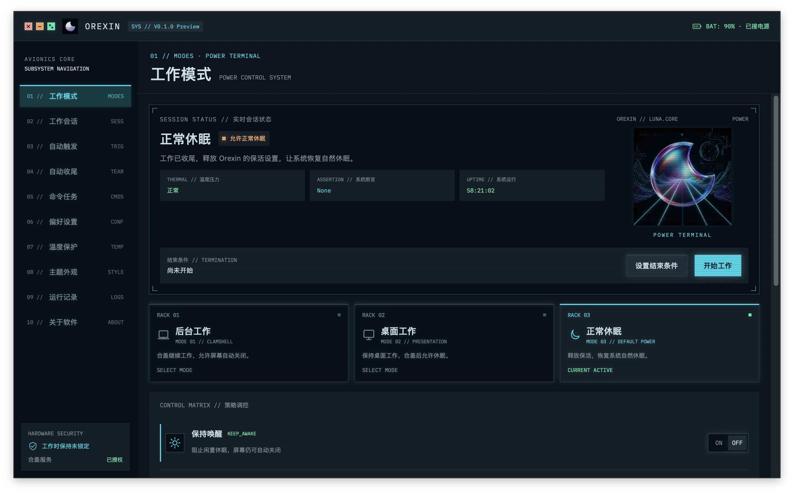
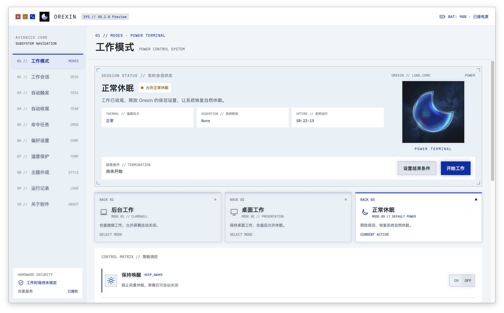
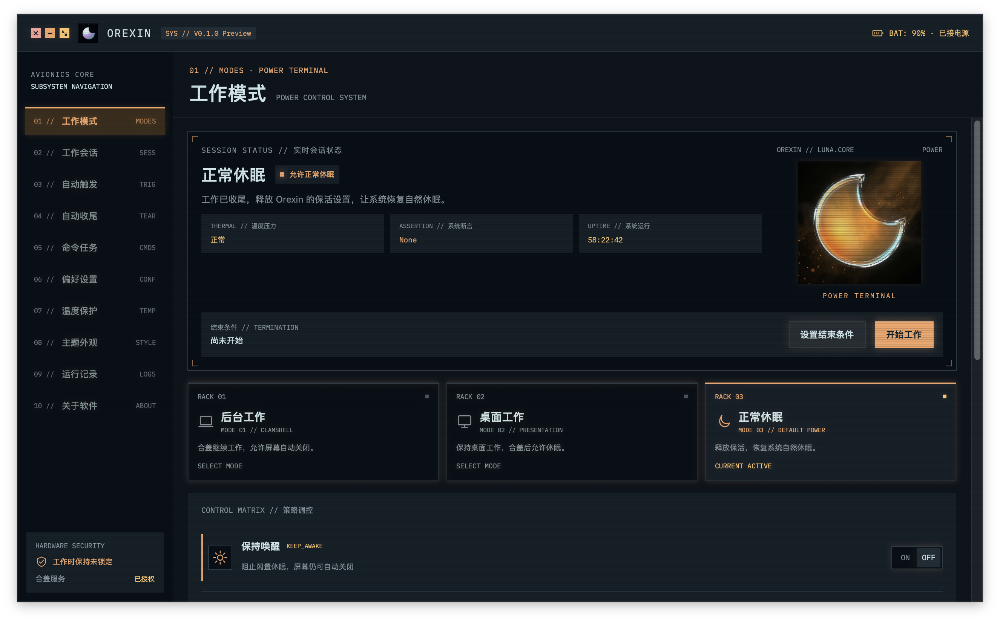

<p align="center">
  <a href="https://github.com/Orxooo/Orexin/releases/tag/v0.3.0-preview.1"></a>
</p>

<h1 align="center">Orexin</h1>
<p align="center"><strong>让 Mac 在工作时保持唤醒，在任务结束后安心休息。</strong></p>

<p align="center">
  <a href="https://github.com/Orxooo/Orexin/releases/tag/v0.3.0-preview.1"></a>
  
  <a href="https://github.com/Orxooo/Orexin/actions/workflows/compatibility.yml"></a>
  <a href="LICENSE"></a>
</p>

<p align="center">
  <strong>简体中文</strong> · <a href="README.en.md">English</a><br><br>
  <a href="https://github.com/Orxooo/Orexin/releases/tag/v0.3.0-preview.1"><strong>下载 V0.3.0 Preview.1 ↗</strong></a> &nbsp; · &nbsp;
  <a href="#开始使用">安装指南</a> &nbsp; · &nbsp;
  <a href="https://github.com/Orxooo/Orexin/wiki">使用手册</a> &nbsp; · &nbsp;
  <a href="https://github.com/Orxooo/Orexin/discussions">社区讨论</a>
</p>

---

Orexin 是一款原生 macOS 菜单栏工具。为编译、下载、演示或一段专注时间开启工作会话，选择屏幕与合盖行为，再让它在你设定的条件满足后收尾。

**保持唤醒 → 完成工作 → 恢复休眠。** 主窗口与菜单栏共用状态，切换后读取系统结果，让每次操作都有回音。

## 看看它的样子

<a href="Assets/README/power-terminal.png"></a>

<p align="center"><sub>V0.1.0 Preview · 创：电子世界争霸战主题 · 软件真实截图</sub></p>

<table>
  <tr>
    <td width="50%"><a href="Assets/README/zima-blue.png"></a></td>
    <td width="50%"><a href="Assets/README/blade-runner.png"></a></td>
  </tr>
  <tr>
    <td align="center"><strong>齐马蓝</strong><br><sub>冷静的浅色工作台</sub></td>
    <td align="center"><strong>银翼杀手 2049</strong><br><sub>深色中的琥珀光</sub></td>
  </tr>
</table>

三套主题同步更换界面色彩与月相素材。支持简体中文、繁体中文、English、日本語、Français、Deutsch、Español，以及可选的短促机械点击声。

## 把工作交给会话

| 你要做的事 | Orexin 如何配合 |
| --- | --- |
| **合上屏幕继续工作** | 后台工作预设保持系统运行；按提示授权合盖服务与本次未锁定工作。 |
| **在桌面演示或处理长任务** | 桌面工作预设防止闲置休眠，合盖后仍允许系统休眠。 |
| **到点或任务完成后结束** | 按持续时长、指定时间、应用／进程退出或所选下载完成来收尾。 |
| **让命令自己跑完** | 并行执行非交互前台 zsh 命令；各项独立保活与记录日志，满足全部成功和无其他保活来源时再倒计时休眠。 |
| **让常用场景自动开始** | 用电源、显示器、设备、应用、网络或周计划组合触发条件；手动操作始终优先。 |
| **及时释放保活** | 会话结束、低电量或温度保护触发时进入收尾流程，恢复系统休眠与密码策略。 |

屏幕行为独立于工作预设：可选**亮度 0%、正常亮度、按系统时间熄屏**，也可一次性立即熄屏。后台与桌面工作分别记住你的选择。

[查看完整功能与边界 →](FEATURES.md)

## 开始使用

### 系统要求

**Apple Silicon Mac · macOS 15 或更新版本。** 当前提供 arm64 安装包。

1. 打开 [V0.3.0 Preview.1 发布页](https://github.com/Orxooo/Orexin/releases/tag/v0.3.0-preview.1)，下载 `Orexin-0.3.0-Preview.1-arm64.zip`。
2. 解压，将 `Orexin.app` 移入「应用程序」并打开。升级前等待内置命令结束、结束保活并退出旧版，再替换应用；现有 Orexin 数据与偏好保留。
3. 选择工作预设和结束条件。需要合盖运行时，按「偏好设置」指引批准辅助服务；本次未锁定工作由你在原生窗口亲自授权。

> [!IMPORTANT]
> **这是预览版。** 安装包使用 Apple Development 签名，尚未完成 Developer ID 公证。首次打开可能被 macOS 阻止，请核对来源和发布页的 `SHA256SUMS.txt`，再按系统「隐私与安全性」提示处理。无需关闭全局 Gatekeeper 或系统完整性保护。

<details>
<summary><strong>校验下载文件</strong></summary>

把 ZIP 和发布页的 `SHA256SUMS.txt` 下载到同一目录，然后运行：

```sh
shasum -a 256 -c SHA256SUMS.txt
```

显示 `Orexin-0.3.0-Preview.1-arm64.zip: OK` 表示校验值一致。

</details>

<details>
<summary><strong>授权、屏幕与休眠：先了解这些</strong></summary>

- **密码只在原生授权窗口输入。** Orexin 不保存密码，也不会自动解锁已锁定的 Mac。仅在你明确授权本次未锁定工作后，才会暂时关闭唤醒密码要求；工作结束、退出或辅助服务恢复时恢复即时密码保护。
- **最低亮度与熄屏行为不同。** 亮度 0% 保留显示器会话；真正熄屏可能影响依赖显示器的截图和界面自动化。
- **恢复正常休眠会释放 Orexin 自身的保活。** 其他应用或系统设置仍可能影响实际休眠时机。
- **需要权限或系统状态的条件会如实显示未知。** Wi-Fi 名称受定位权限保护；Cisco VPN 仅识别系统公开的连接状态，不推测连接结果。

详见 [安全说明](SECURITY.md) 与 [功能清单](FEATURES.md)。

</details>

## 任务管理与 CLI

V0.3.0 Preview.1 新增专业规则、电源分析和可复用工作配置：嵌套条件与只读试运行、系统断言来源与事件时间线、带差异预览的 JSON 配置导入/导出。参见 [工作配置指南](docs/WORK-CONFIGURATION.md)。工作配置可保存通知与本机结果脚本，并在任务开始时采用配置快照。

「任务管理」包含 **任务列表 / 运行命令 / 工作配置 / 外部接入**。可以并行启动命令，分别查看日志、实际退出码与保活状态，并独立释放每项请求。

单项完成不会结束其他任务的保活。只有所有重叠请求成功、且没有手动工作、会话或规则仍需保活时，才进入可取消的 60 秒休眠倒计时。释放保活和全部停止都不会杀死运行中的命令。

安装并打开应用后，直接使用内置 CLI：

```sh
orexin=/Applications/Orexin.app/Contents/Helpers/orexin
"$orexin" help
"$orexin" run --title Build -- make
"$orexin" list --json
```

`run` 包装前台命令并报告实际结果；外部工具也可用 `register`、`heartbeat`、`complete` 等命令管理任务生命周期。本地接口仅对当前用户开放，不监听网络端口。应用必须保持运行；重启不会重放命令或恢复旧请求。

完整选项和外部工具接入示例见 [CLI 与并行请求指南](docs/CLI.md)。应用安装在其他位置时，可从「外部接入」复制准确路径。

## 从源码构建

需要 **Xcode 26+ 与 Swift 6**；持续集成使用 Xcode 26.3，在 macOS 15 和 26 上编译、测试并生成应用包。

```sh
git clone https://github.com/Orxooo/Orexin.git
cd Orexin
swift test --arch arm64 --scratch-path /tmp/orexin-test-build
./scripts/build-app.sh
```

应用生成于 `/tmp/orexin-dist/Orexin.app`。默认使用 ad hoc 签名；需要合盖服务时，主程序与辅助服务须使用同一 Apple 开发者证书签名：

```sh
OREXIN_SIGN_IDENTITY='证书名称或 SHA-1' ./scripts/build-app.sh
```

`OREXIN_BUILD_DIR` 与 `OREXIN_OUTPUT_DIR` 可指定仓库外的构建和输出位置。构建脚本不注册系统服务，也不修改系统权限。

<details>
<summary><strong>AppleScript 与本地数据</strong></summary>

```applescript
tell application "Orexin"
    start session mode "desktop" for minutes 30
    session status
    -- end session
end tell
```

脚本、快捷键与界面共用状态核验。完整词典见 [Orexin.sdef](Resources/Orexin.sdef)。

- Bundle ID：`com.orxooo.Orexin`
- 偏好设置键：`orexin.` 前缀
- 本地运行记录、命令日志和自定义资源：`~/Library/Application Support/Orexin/`
- 旧 WakeMac 的数据不会自动迁移或删除；分享日志前请检查私人信息。

</details>

## 一起把它做好

| 入口 | 适合什么 |
| --- | --- |
| [Releases](https://github.com/Orxooo/Orexin/releases) | 下载、更新说明与文件校验 |
| [Wiki](https://github.com/Orxooo/Orexin/wiki) | 安装、常见问题与操作指引 |
| [Discussions](https://github.com/Orxooo/Orexin/discussions) | 使用问答、想法交流与分享工作方式 |
| [Issues](https://github.com/Orxooo/Orexin/issues/new/choose) | 可复现的问题与范围明确的功能建议 |
| [私密漏洞报告](https://github.com/Orxooo/Orexin/security/advisories/new) | 认证、越权或隐私问题，请勿公开利用细节 |

欢迎文档修正、翻译与聚焦的代码改进。提交前请读 [贡献指南](CONTRIBUTING.md) 和 [行为准则](CODE_OF_CONDUCT.md)。

## 许可

**GPL-3.0-only · © 2026 Orxooo。** 允许使用、修改和商业使用；对外分发衍生版本时，需按 GPL 提供对应源码并保留许可与版权声明。第三方字体等资源遵守各自许可，见 [LICENSE](LICENSE) 与 [NOTICE](NOTICE)。

<p align="center"><sub>Keep working. Rest when done.</sub></p>
